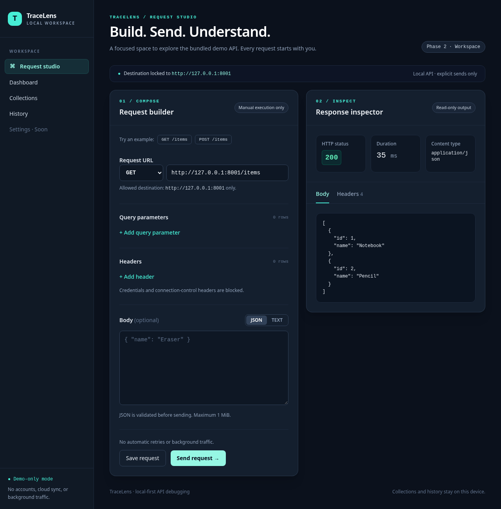
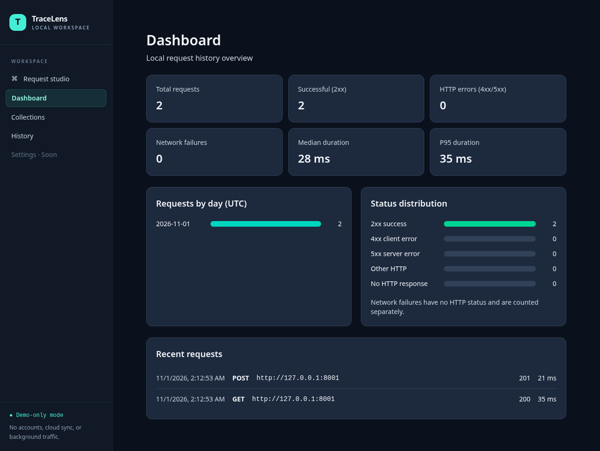

# TraceLens — Local-first API debugging and observability workspace

TraceLens is a **local-first API debugging workspace** for sending a request to the bundled demo service, inspecting the response, and reviewing local request metrics. It is a demo-only tool, **not** an unrestricted HTTP client or a public proxy. No account, cloud service, or telemetry is required.

## What works today

- **Request studio:** compose a manual GET, POST, PUT, PATCH, or DELETE request with query parameters, permitted headers, and a JSON or text body. Inspect status, duration, response headers, and safely displayed text/JSON responses. Example GET and POST requests are built in.
- **Dashboard:** view counts by status, daily traffic, median/p95 duration, and recent attempts from local history.
- **Collections:** create, rename, and delete collections; save, edit, duplicate, and load requests. Import/export versioned JSON with validation and secret-header filtering. Bodies require explicit opt-in to persist and are never exported.
- **History:** search, sort, paginate, and clear sanitized attempt metadata with confirmation.
- **Backend API:** send guarded requests; record sanitized attempt metadata; manage collections and saved request templates; search, sort, and clear history; import/export collections as versioned JSON.
- **Demo API:** deterministic `GET /items` and `POST /items` examples. POST returns an item but does not change the demo data.

**Settings** is not implemented; the backend's environment variables provide local configuration. Consult the [project specification](TraceLens_Project_Specification.md) for the intended roadmap, not as a list of already shipped features.





## Tech stack

| Layer | Technologies | Role |
| --- | --- | --- |
| Web | React 19, TypeScript, Vite, Tailwind CSS 4, TanStack Query | Request editor, response inspector, dashboard, API calls |
| API | Python 3.12–3.14, FastAPI, Pydantic 2, httpx | Validation, REST endpoints, guarded outbound HTTP |
| Persistence | SQLite, SQLAlchemy 2, Alembic | Local collections, saved templates, attempt history, migrations |
| Demo target | FastAPI | Stateless sample HTTP endpoints |
| Tooling | uv, npm, Ruff, mypy, pytest, Vitest, ESLint, Prettier, Docker Compose, GitHub Actions | Locked dependencies, checks, local stack and CI |

## Architecture and data flow

```text
Browser (:5173) ── REST /api/v1 ──> FastAPI (:8000)
                                      ├─> validate destination, headers and limits
                                      ├─> resolve/pin demo address ── httpx ──> Demo API (:8001)
                                      └─> SQLAlchemy ──> SQLite (data/tracelens.sqlite3)
```

The browser does **not** contact the demo API to send a request: the backend does so only after an explicit Send action (or a direct call to `POST /api/v1/requests/send`). The backend accepts only its configured demo origin: `http://demo-api:8001` inside Compose, or `http://127.0.0.1:8001` when running locally. It rejects unrelated destinations and redirects, and connects to a freshly checked, pinned IPv4 address without using environment proxies. Requests are not automatically retried.

After a send, the API returns the HTTP status, duration, filtered headers, an optional text body, and a truncation indicator; errors have a `{ "code", "message", "details" }` shape. Successful HTTP error responses (for example, 404) remain normal send results; blocked destinations and connection failures are API errors. Sends with a valid JSON request payload are recorded in SQLite with **metadata only**, including downstream failures: method, sanitized destination (demo origin without path/query), status or error code, duration, size, and timestamp. Requests rejected before payload validation are not recorded. Request/response bodies and headers are not stored in history. Saved templates are different: their URL, query and allowed headers are stored, and a body is stored **only if `persist_body` is explicitly true**. Do not put secrets in templates or assume they are encrypted.

## Quick start with Docker

Requires Docker Engine with Compose v2 (or Docker Desktop). From the repository root:

```sh
docker compose up --build -d --wait
```

Compose builds and starts the web app, API, and demo service; the API container runs database migrations before serving. Visit:

| Service | Local URL |
| --- | --- |
| Web UI | http://127.0.0.1:5173/ |
| TraceLens API health | http://127.0.0.1:8000/api/v1/health |
| Interactive API docs | http://127.0.0.1:8000/docs |
| Demo items | http://127.0.0.1:8001/items |

The web image embeds `http://demo-api:8001` as the **backend request destination**, not a browser fetch target. The browser talks only to the API on `127.0.0.1:8000`, which resolves that Compose-internal name. Local development uses `http://127.0.0.1:8001` as the backend destination instead. The Docker browser flow is covered by the same API contract but needs a manual Compose verification on a host with a running Docker daemon.

Compose publishes ports on **127.0.0.1 only**. To change published ports or the host data directory, copy `.env.example` to `.env` and edit the values before starting Compose. Keep the internal demo origin on port 8001; `TRACELENS_DEMO_PORT` changes only the host-published demo port. SQLite persists in `./data/tracelens.sqlite3` by default (or `TRACELENS_DATA_DIR/tracelens.sqlite3`).

```sh
docker compose logs -f    # view startup/runtime logs (Ctrl+C to stop following)
docker compose down       # stop containers; keep local database files
```

### Try a request through the API

With Compose running:

```sh
curl -X POST http://127.0.0.1:8000/api/v1/requests/send \
  -H 'Content-Type: application/json' \
  -d '{"method":"GET","url":"http://demo-api:8001/items","headers":{},"query":{},"body":null}'
```

For the non-Docker setup below, replace the JSON `url` with `http://127.0.0.1:8001/items`. Try `POST /items` with `"body":"{\"name\":\"Eraser\"}"` and `"headers":{"Content-Type":"application/json"}`. `GET /redirect` demonstrates redirect rejection; a URL outside the configured demo origin returns `DESTINATION_BLOCKED`.

## Local development

Requires Python **3.12–3.14**, [uv 0.13.6](https://docs.astral.sh/uv/), Node.js **22+**, npm, and Make. Run the following from the repository root unless stated otherwise:

```sh
make install   # uv sync --frozen and npm ci
uv run --frozen alembic -c apps/api/alembic.ini upgrade head
```

Start each service in its **own terminal** (from the repository root):

```sh
uv run --frozen uvicorn --app-dir demo-api main:app --host 127.0.0.1 --port 8001 --no-access-log
```

```sh
uv run --frozen uvicorn --app-dir apps/api app.main:app --host 127.0.0.1 --port 8000 --no-access-log
```

```sh
cd apps/web && npm run dev
```

Open http://127.0.0.1:5173/ and choose **GET /items** in Request studio, then **Send request**. Visit **History** and **Dashboard** to review recorded attempts. Try **POST /items**, choose **Save request**, create a collection, save the template, and reload to verify persistence. The demo service must be running for sends to succeed. Local runs default to `./data/tracelens.sqlite3`; the local shell does **not** automatically load `.env`. If you set `TRACELENS_DATA_DIR` for a local run, set it for **both** migrations and the API. Other supported settings include `TRACELENS_WEB_PORT` (API CORS origin), `TRACELENS_SENSITIVE_HEADERS` (comma-separated additional header names to block/redact), and the frontend build-time `VITE_API_BASE_URL` (must be `http://127.0.0.1:<port>`). The backend demo origin is deliberately restricted to its two built-in values; changing a host-published port does not change the service-to-service port.

## API at a glance

Routes are under `/api/v1` and documented interactively at `/docs` on the API host.

| Method | Path | Purpose |
| --- | --- | --- |
| GET | `/health` | Health check |
| POST | `/requests/send` | Send a manual request to the demo API |
| GET, POST, PATCH, DELETE | `/collections` and `/collections/{id}` | List/create/rename/delete collections (PATCH/DELETE use `{id}`) |
| POST | `/collections/{id}/requests` | Save a request template |
| PATCH, DELETE | `/saved-requests/{id}` | Edit/delete a template |
| GET, DELETE | `/history` | Paginated/filterable history or clear all history |
| GET | `/stats/summary` | Aggregate history for the dashboard |
| GET, POST | `/export`, `/import` | Export/import versioned collection JSON |

History supports `page`, `page_size`, `search`, `method`, `status`, and `sort` (`newest`, `oldest`, `duration_asc`, `duration_desc`). Import/export covers collections and templates, **not** history or bodies; validate imported files and avoid adding secrets. To inspect a fresh database, send a request first, then visit the Dashboard or call `GET /api/v1/stats/summary`.

## Safety and limits

- This is a **demo-only local tool**, not a general-purpose proxy. Do not expose it to a network or point the demo service at untrusted targets. Compose binds published ports to localhost; the development servers do too.
- Credential and connection-control request headers are rejected. CORS permits only the configured local frontend origin; it is not authentication.
- Common credential-like header names and any names in `TRACELENS_SENSITIVE_HEADERS` are blocked on send and template import. Sensitive response headers and headers in older saved templates are omitted from results, listings, and exports. Neither user-entered paths nor explicitly saved template bodies are encrypted; never put credentials in them.
- Request and response bodies are capped at **1 MiB**. Oversized responses are flagged as truncated; binary/compressed bodies are not displayed. The UI renders returned text as text, not HTML.
- History deliberately omits paths, query strings, headers, and bodies. Saved templates can contain user-supplied data; use them only for non-sensitive examples.
- No interception, scanning, background request scheduling, cloud sync, or automatic retries.

See [security design](docs/security/phase-1.md) and [dashboard metrics](docs/architecture/phase-4.md) for more detail.

## Development checks and repository layout

```sh
make check    # Python format/lint/typecheck/tests + web format/lint/tests/build
make format   # apply Python and frontend formatting
make up       # docker compose up --build -d --wait
make down     # docker compose down
cd apps/web && npm run test:e2e  # Chromium smoke tests; starts three local services
```

| Path | Contents |
| --- | --- |
| `apps/web/` | React app, request workspace, dashboard, API client, frontend tests |
| `apps/api/app/` | FastAPI routes, request guard, persistence, stats, schemas/models |
| `apps/api/alembic/` | SQLite migrations |
| `apps/api/tests/` and `demo-api/tests/` | Python tests |
| `demo-api/` | Stateless sample API |
| `docs/` | Design notes, security boundary and decisions |
| `compose.yaml`, `.env.example` | Local service orchestration and port/data settings |
| `pyproject.toml`, `uv.lock`, `apps/web/package-lock.json` | Dependency definitions and lockfiles |

Licensed under [MIT](LICENSE).

## Release verification and walkthrough

The Playwright smoke tests start the local demo API, migrated API, and Vite UI against a **fresh, isolated SQLite database**. They check GET/POST, saving across reload, history and dashboard, blocked destinations, malformed imports, keyboard navigation, and mobile width. They also generate the screenshots above. Install the browser with `cd apps/web && npx playwright install chromium` before running them. Stop any services already using ports 8000, 8001, or 5173. CI runs `make check`, Playwright, and a separate Compose smoke test.

Watch the [33-second browser walkthrough](docs/walkthrough.webm): Request studio → GET and response inspection → headers → POST → save a request to a collection → History → Dashboard. It was captured with real demo-only browser interactions using `cd apps/web && npm run record:walkthrough`, not synthetic data. **Human review of the recording is still required.** See the [release acceptance checklist](docs/release/phase-5-checklist.md) before shipping; do not tag a release until the manual checks, Docker browser verification, dependency/asset review, and video review are complete.

**Engineering tradeoffs:** localhost-only published ports and a pinned, allowlisted demo destination avoid creating a public SSRF-capable proxy; SQLite needs no account/server and persists local metadata; 1 MiB caps bound memory and rendering; explicit non-goals include interception, scanning, traffic scheduling, and telemetry. The current implementation and tests were prepared with AI assistance. Automated checks and the local Chromium E2E flow were run; human review of security assumptions, accessibility across assistive technologies, the Docker browser flow, and all release assets remains outstanding.
